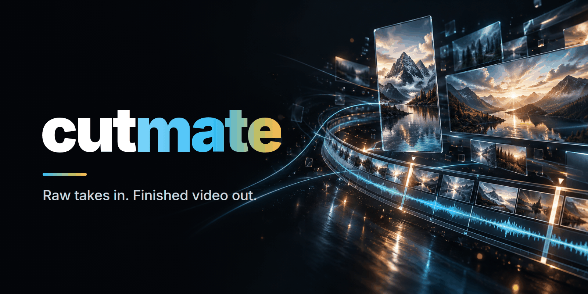

<p align="center">
  
</p>

<p align="center">
  <a href="LICENSE"></a>
  
  
  
</p>

# cutmate

> Plugin do Claude Code, który z folderu surowych nagrań, w których mówisz do kamery, robi gotowy film z napisami i animacjami.

cutmate to open-source'owy plugin do Claude Code. Wskazujesz mu folder z surowymi nagraniami, a Claude montuje je tak, jak zrobiłby to człowiek. Transkrybuje każde ujęcie słowo po słowie, ogląda klatki, wybiera najlepsze ujęcie każdej kwestii i wycina falstarty oraz powtórki. Potem wyrównuje głośność głosu do −14 LUFS, dodaje napisy zsynchronizowane ze słowami i animowane grafiki z motywu, a na koniec renderuje film. Robi shorty 9:16 i filmy 16:9 na YouTube. Kontrola zostaje u ciebie: przed renderem Claude pokazuje ci, co zrozumiał („zrozumiałem tak”), i czeka na twoje OK.

## Najważniejsze funkcje

- **Ujęcia wybrane tak, jak wybrałby je montażysta.** Claude sprawdza podejrzane słowa, skanuje głośność, czyta arkusze klatek (contact sheets) i porównuje każde ujęcie powtarzanej kwestii. Każdy wybór trafia do `takes.md` razem z uzasadnieniem.
- **Shorty i długie filmy.** Shorty 9:16 z wypalonymi napisami. Filmy 16:9 z rozdziałami (`chapters.txt`), plikiem `.srt`, podglądem 480p do zatwierdzenia i belkami z imieniem (lower-third).
- **Napisy zsynchronizowane ze słowami** dzięki wymuszonemu wyrównaniu (forced alignment) wav2vec2, z wyróżnionymi słowami kluczowymi.
- **Animowane grafiki z motywu:** tytuły, liczniki, listy, etykiety, stemple, wykresy słupkowe, b-roll na podzielonym ekranie, obraz w obrazie i plansze rozdziałów. Renderuje je [HyperFrames](https://github.com/heygen-com/hyperframes) (HTML do wideo).
- **Explainery i 6 efektów „WOW”:** karty z liczbami, diagramy przepływu, makiety interfejsów, izometryczna maszyna, checklisty, rozłożony model 3D, globus, wybuch 3D zza twoich pleców, iskry podążające za dłonią, glitch przy zmianie tematu i kinetyczne słowo.
- **Efekty na życzenie**, na czacie albo powiedziane na głos w nagraniu („tu daj kosmiczne tło”). Gdy nic wbudowanego nie pasuje, Claude pisze nowy efekt. Te, które ci się spodobają, możesz zapisać w swoim motywie.
- **Efekty sterowane gestem.** MediaPipe śledzi twarz i dłonie, więc efekt może pojawić się na otwartej dłoni albo w miejscu, które wskazujesz palcem.
- **Motywy:** neutralny motyw `clean`, twoje własne kolory i fonty, „zaskocz mnie” (losowy, odważny wygląd) albo klon stylu filmu, który ci się podoba. Klon potrafi też skopiować układ ze stałym panelem u góry.
- **Fact-check, QA i miniatura.** Gdy fact-check jest włączony (`steps.factcheck`), Claude sprawdza twierdzenia możliwe do zweryfikowania, a build automatycznie oznacza tylko niektóre liczby (liczniki, wartości `stat-card`, podsumowanie `checklist`), których nie potwierdza `factcheck.md`. Po renderze cutmate szuka przeoczonych powtórek i sprawdza poziomy w miksie. Miniatura powstaje z klatki i tytułu.
- **Transkrypcja lokalna albo przez API:** Whisper large-v3 na twoim GPU (NVIDIA CUDA lub Apple Silicon) albo Groq, OpenAI czy ElevenLabs.
- **Rendery offline.** Każda biblioteka JavaScript ma przypiętą wersję i sprawdzaną sumę sha, a zasoby kompozycji są lokalne, więc render nie sięga do CDN. Sieć jest potrzebna tylko przy pierwszym uruchomieniu narzędzi (`npx hyperframes`, `@hyperframes/core` dla muzyki, GSAP przez `cutmate vendor`); potem rendery działają offline.

## Szybki start

**1. Zainstaluj plugin w Claude Code.** cutmate zależy od pluginu HyperFrames, więc dodaj oba marketplace'y, a potem zainstaluj:

```text
/plugin marketplace add heygen-com/hyperframes
/plugin marketplace add wisniewskib/cutmate
/plugin install cutmate@cutmate
```

Możesz też uruchomić go prosto z klona, bez marketplace'u:

```bash
git clone https://github.com/wisniewskib/cutmate.git
claude --plugin-dir ./cutmate
```

**2. Uruchom kreator konfiguracji** (raz). Wykrywa system i GPU, a po twojej zgodzie instaluje zależności. Potem pozwala wybrać i przetestować backend transkrypcji, pobiera modele, pyta o muzykę, napisy i wygląd twoich filmów, a na koniec robi 5-sekundowy render testowy.

```text
/cutmate:setup
```

**3. Zmontuj film.** Wrzuć surowe nagrania do jednego folderu. cutmate nigdy ich nie zmienia; wszystko, co generuje, trafia do `<folder>/out/`. Folder `broll/` to wejścia (twoje pliki oraz pobrane zrzuty stron i obrazy); cutmate nigdy nie nadpisuje w nim istniejących plików.

```text
/cutmate:edit ~/Videos/my-short
```

Na Windowsie wpisz ścieżkę tak jak zwykle, na przykład `/cutmate:edit C:\Users\me\Videos\my-short`.

Dostajesz `out/final.mp4`, do tego `out/thumbnail.png` i notatki, które wyjaśniają każdą decyzję. Film 16:9 dostaje też `out/chapters.txt`, a jeśli wybrałeś napisy srt, również `out/captions.srt`.

## Wymagania

| Co | Wersja / uwagi |
|---|---|
| Claude Code | Z obsługą pluginów |
| System | Windows 10/11 (Git Bash z Claude Code), macOS, Linux |
| Python | 3.10 lub nowszy (setup tworzy własny venv w `~/.cutmate/venv`) |
| Node.js | 22 lub nowszy (`npx` uruchamia HyperFrames 0.8.157) |
| ffmpeg | Dowolna świeża wersja, dostępna w `PATH` |
| Google Chrome / Chromium / Edge | Tylko do zrzutów stron przez `cutmate shot` (HyperFrames do renderowania ma własnego headless Chrome) |
| Dysk | Około 8 GB wolnego miejsca na venv i modele |
| GPU (opcjonalnie) | Karta NVIDIA z aktualnym sterownikiem (biblioteki CUDA 12 przychodzą z pip) albo Apple Silicon. Bez GPU użyj backendu przez API. |
| Klucz API (opcjonalnie) | `GROQ_API_KEY`, `OPENAI_API_KEY` albo `ELEVENLABS_API_KEY`, ustawiony wyłącznie jako zmienna środowiskowa |

`/cutmate:setup` sprawdza to wszystko i wypisuje polecenie instalacji dla każdej brakującej rzeczy. Szczegóły dla poszczególnych systemów znajdziesz w [docs/installation.md](docs/installation.md).

## Jak to działa


Claude Code prowadzi cały proces przez CLI `cutmate` (Python). CLI robi ciężką robotę: transkrypcję, cięcie, wyrównanie, śledzenie, budowanie kompozycji, renderowanie i kontrolę głośności. Claude podejmuje decyzje montażowe i zapisuje je w plikach: `takes.md`, `edl.json` (cięcie) i `plan.json` (grafiki). Każdy krok możesz przeczytać, wznowić albo zmienić. Szczegóły znajdziesz w [docs/architecture.md](docs/architecture.md).

## Skille

| Skill | Co robi |
|---|---|
| `/cutmate:setup` | Kreator instalacji i konfiguracji: sprawdzenie systemu, zależności, venv, backend transkrypcji i jego test, język, modele, muzyka, napisy, kroki opcjonalne, motyw i 5-sekundowy render testowy. Uruchom go ponownie, żeby zmienić pojedynczą sekcję. |
| `/cutmate:edit <folder>` | Montuje short (9:16) albo długi film (16:9) z surowych nagrań, od transkrypcji aż po `final.mp4`, miniaturę i `EDIT_NOTES.md`. |
| `/cutmate:theme` | Tworzy albo wybiera wygląd: „zaskocz mnie” (losowy, odważny motyw), twoje własne kolory i fonty albo zmiana aktywnego motywu. Każdy motyw przed zapisaniem jest sprawdzany na arkuszu klatek. |
| `/cutmate:clone-style` | Buduje motyw wyglądający jak rolka, film, zrzuty ekranu albo folder, który ci się podoba (paleta, fonty, kształty, napisy, ruch i układ), i porównuje go ze źródłem obok siebie. |

## Dokumentacja

| Temat | Plik |
|---|---|
| Instalacja na Windowsie, macOS i Linuksie; GPU; klucze API; rozwiązywanie problemów | [docs/installation.md](docs/installation.md) |
| Przebieg montażu, prośby, punkt kontrolny, pliki wynikowe | [docs/usage.md](docs/usage.md) |
| Motywy, „zaskocz mnie”, clone-style, układy, tokeny, fonty | [docs/themes.md](docs/themes.md) |
| Explainery, 6 efektów WOW, własne efekty, umieszczanie gestem | [docs/effects.md](docs/effects.md) |
| Każdy klucz `cutmate config`, napisy, muzyka | [docs/configuration.md](docs/configuration.md) |
| Każde polecenie i flaga CLI | [docs/cli.md](docs/cli.md) |
| Struktura repo, HyperFrames, `plan.json` / `edl.json`, biblioteki offline | [docs/architecture.md](docs/architecture.md) |
| Biblioteki, modele, wersje i licencje | [docs/libraries.md](docs/libraries.md) |
| Własny skill na bazie cutmate, własne motywy, zapisane efekty | [docs/customizing.md](docs/customizing.md) |
| FAQ | [docs/faq.md](docs/faq.md) |
| Współtworzenie: środowisko deweloperskie, testy, konwencje, zasady dla Windowsa | [CONTRIBUTING.md](CONTRIBUTING.md) |

## Język

cutmate montuje filmy **po polsku (`pl`) albo po angielsku (`en`)**: transkrypcja, wyrównanie i etykiety w grafikach idą za kluczem `language` w konfiguracji. Skille rozmawiają z tobą w twoim języku.

## Licencja

[MIT](LICENSE) © 2026 Bartosz Wiśniewski. Dołączone pliki zewnętrzne zachowują własne licencje; zobacz [docs/libraries.md](docs/libraries.md).

Tekst w pliku [LICENSE](LICENSE) zostaje po angielsku, bo to standardowy, prawnie obowiązujący tekst licencji MIT.

cutmate to niezależny projekt. Nie jest powiązany z Anthropic ani HeyGen i nie jest przez nie wspierany.
