<p align="center">
  
</p>

<p align="center">
  <a href="LICENSE"></a>
  
  
  
</p>

# cutmate

> A Claude Code plugin that turns a folder of raw talking-head takes into a finished, captioned, animated video.

cutmate is an open-source plugin for Claude Code. You point it at a folder of raw recordings and Claude edits them like a human editor. It transcribes every take word by word, looks at the frames, picks the best take of each line, and cuts out false starts and retakes. Then it levels the voice to −14 LUFS, adds word-aligned captions and themed motion graphics, and renders the result. It makes 9:16 shorts and 16:9 YouTube videos. You stay in control: before the render Claude shows you what it understood ("zrozumiałem tak", Polish for "here's what I understood") and waits for your OK.

## Highlights

- **Takes picked like an editor would pick them.** Claude probes suspicious words, scans loudness, reads contact sheets of frames, and compares every take of a repeated line. Each choice is written to `takes.md` with a reason.
- **Shorts and long-form.** 9:16 shorts with burned-in captions. 16:9 videos with chapters (`chapters.txt`), an `.srt` file, a 480p preview checkpoint and lower-thirds.
- **Word-aligned captions** from wav2vec2 forced alignment, with key words highlighted.
- **Motion graphics from a theme:** titles, counters, lists, chips, stamps, bars, split-screen b-roll, picture-in-picture and chapter plates. They are rendered with [HyperFrames](https://github.com/heygen-com/hyperframes) (HTML to video).
- **Explainers and 6 "WOW" effects:** stat cards, flow diagrams, UI mockups, an isometric machine, checklists, a 3D exploded view, a globe, a 3D burst from behind the speaker, hand-tracked sparks, a glitch topic change and a kinetic word.
- **Effects you ask for**, in chat or out loud in the recording ("put a space background here"). When nothing built in fits, Claude writes a new effect. You can save the ones you like into your theme.
- **Effects placed by gesture.** MediaPipe tracks your face and hands, so an effect can sit on an open palm or at the spot you point to.
- **Themes:** the neutral `clean` theme, your own colours and fonts, "zaskocz mnie" (surprise me: a random bold look), or a clone of the style of a video you like. A clone can also copy a persistent top-panel layout.
- **Fact-check, QA and a thumbnail.** Every claim is checked against a source before the cut. Repeats and mix levels are checked after the render. A thumbnail is generated from a frame plus a title.
- **Local or API transcription:** Whisper large-v3 on your GPU (NVIDIA CUDA or Apple Silicon), or Groq, OpenAI or ElevenLabs.
- **Offline renders.** Every JavaScript library is pinned and sha-checked, so builds and renders never touch a CDN.

## Quick start

**1. Install the plugin in Claude Code.** cutmate depends on the HyperFrames plugin, so add both marketplaces, then install:

```text
/plugin marketplace add heygen-com/hyperframes
/plugin marketplace add wisniewskib/cutmate
/plugin install cutmate@cutmate
```

Or run it straight from a clone, without the marketplace:

```bash
git clone https://github.com/wisniewskib/cutmate.git
claude --plugin-dir ./cutmate
```

**2. Run the setup wizard** (once). It detects your system and GPU and installs dependencies after you say yes. Then it lets you pick and test a transcription backend, downloads the models, asks about music, captions and the look of your videos, and ends with a 5-second test render.

```text
/cutmate:setup
```

**3. Edit a video.** Put your raw takes in one folder. cutmate never modifies them; everything it makes goes to `<folder>/out/`.

```text
/cutmate:edit ~/Videos/my-short
```

On Windows, write the path the way you normally would, for example `/cutmate:edit C:\Users\me\Videos\my-short`.

You get `out/final.mp4`, plus `out/thumbnail.png` and the notes that explain each decision. A 16:9 video also gets `out/chapters.txt` and, if you chose srt captions, `out/captions.srt`.

## Requirements

| What | Version / notes |
|---|---|
| Claude Code | With plugin support |
| OS | Windows 10/11 (Claude Code's Git Bash), macOS, Linux |
| Python | 3.10 or newer (setup creates its own venv in `~/.cutmate/venv`) |
| Node.js | 22 or newer (`npx` runs HyperFrames 0.8.157) |
| ffmpeg | Any recent build, on `PATH` |
| Google Chrome / Chromium / Edge | Only for `cutmate shot` web-page screenshots (HyperFrames brings its own headless Chrome for rendering) |
| Disk | About 8 GB free for the venv and models |
| GPU (optional) | An NVIDIA card with a current driver (CUDA 12 libraries come from pip) or Apple Silicon. Without a GPU, use an API backend. |
| API key (optional) | `GROQ_API_KEY`, `OPENAI_API_KEY` or `ELEVENLABS_API_KEY`, set as an environment variable only |

`/cutmate:setup` checks all of these and prints the install command for anything that is missing. For per-OS details see [docs/installation.md](docs/installation.md).

## How it works

```mermaid
flowchart LR
    A[Raw takes<br/>folder] --> B[transcribe<br/>word timings]
    B --> C[sheets<br/>Claude reads frames]
    C --> D[takes.md<br/>pick best takes]
    D --> E[factcheck.md]
    E --> F[edl.json]
    F --> G[cut<br/>aroll.mp4 at -14 LUFS]
    G --> H[align<br/>word captions]
    H --> I[track<br/>face + hands]
    I --> J[plan.json<br/>graphics, effects, panel]
    J --> K{{zrozumiałem tak<br/>your OK}}
    K --> L[build<br/>HyperFrames project]
    L --> M[render + finalize<br/>final.mp4]
    M --> N[qa + thumbnail]
```



Claude Code drives the whole flow through the `cutmate` CLI (Python). The CLI does the heavy lifting: transcription, cutting, alignment, tracking, building the composition, rendering and loudness checks. Claude makes the editorial decisions and writes them down: `takes.md`, `edl.json` (the cut) and `plan.json` (the graphics). You can read, resume or change every step. For the details see [docs/architecture.md](docs/architecture.md).

## Skills

| Skill | What it does |
|---|---|
| `/cutmate:setup` | The installation and configuration wizard: system check, dependencies, venv, transcription backend and test, language, models, music, captions, optional steps, theme and a 5 s smoke render. Run it again to change a single section. |
| `/cutmate:edit <folder>` | Edits a short (9:16) or a long-form video (16:9) from raw takes, from transcription to `final.mp4`, the thumbnail and `EDIT_NOTES.md`. |
| `/cutmate:theme` | Creates or picks a look: "zaskocz mnie" (a random bold theme), your own colours and fonts, or switching the active theme. Every theme is checked on a contact sheet before it is saved. |
| `/cutmate:clone-style` | Builds a theme that looks like a reel, a video, screenshots or a folder you like (palette, fonts, shapes, captions, motion and layout), compared side by side with the source. |

## Documentation

| Topic | File |
|---|---|
| Installing on Windows, macOS, Linux; GPU; API keys; troubleshooting | [docs/installation.md](docs/installation.md) |
| The edit workflow, requests, the checkpoint, outputs | [docs/usage.md](docs/usage.md) |
| Themes, "zaskocz mnie", clone-style, layouts, tokens, fonts | [docs/themes.md](docs/themes.md) |
| Explainers, the 6 WOW effects, custom effects, gesture placement | [docs/effects.md](docs/effects.md) |
| Every `cutmate config` key, captions, music | [docs/configuration.md](docs/configuration.md) |
| Every CLI command and flag | [docs/cli.md](docs/cli.md) |
| Repo layout, HyperFrames, `plan.json` / `edl.json`, offline vendoring | [docs/architecture.md](docs/architecture.md) |
| Libraries, models, versions and licences | [docs/libraries.md](docs/libraries.md) |
| Your own skill on top of cutmate, your own themes, saved effects | [docs/customizing.md](docs/customizing.md) |
| FAQ | [docs/faq.md](docs/faq.md) |
| Contributing: dev setup, tests, conventions, Windows rules | [CONTRIBUTING.md](CONTRIBUTING.md) |

## Language

cutmate edits videos in **Polish (`pl`) or English (`en`)**: transcription, alignment and the labels in graphics all follow the config `language`. The skills talk to you in your language. Some built-in labels and checkpoint names are Polish ("zrozumiałem tak", "zaskocz mnie"); each one is explained where it appears in these docs.

## License

[MIT](LICENSE) © 2026 Bartosz Wiśniewski. Bundled third-party files keep their own licences; see [docs/libraries.md](docs/libraries.md).

cutmate is an independent project. It is not affiliated with or endorsed by Anthropic or HeyGen.
