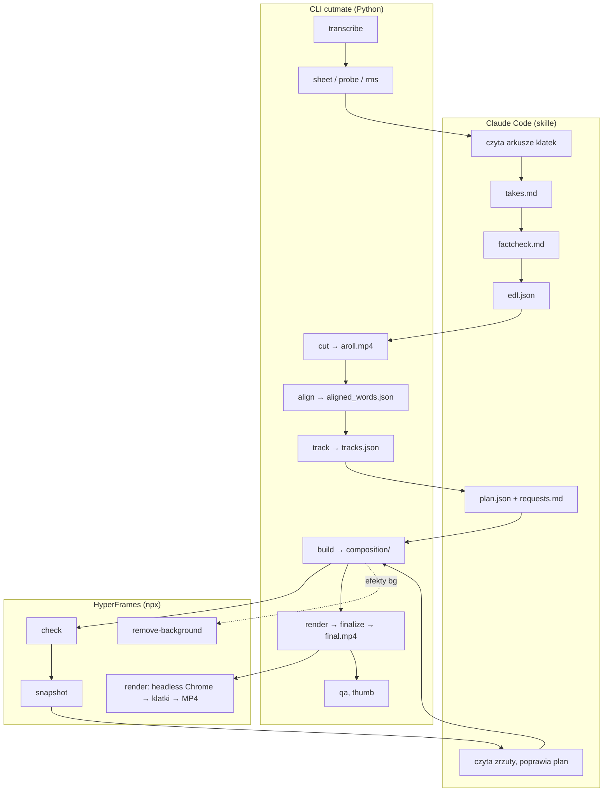

# Architektura

Ta strona wyjaśnia, jak zbudowany jest cutmate: kto o czym decyduje, gdzie leżą pliki, jakie są dwa kontrakty między Claude'em a silnikiem (`edl.json` i `plan.json`) i jak rendery pozostają offline i deterministyczne.

## Główna idea: Claude decyduje, CLI wykonuje

cutmate składa się z dwóch połówek:

| Połówka | Co to jest | Odpowiedzialność |
|---|---|---|
| **Skille** (`skills/*/SKILL.md`) | Instrukcje, którymi kieruje się Claude Code | Ocena montażowa: czytanie klatek, wybór ujęć, fact-checking, mapowanie próśb, planowanie grafik, sprawdzanie zrzutów, rozmowa z tobą |
| **Silnik** (`core/cutmate/`, CLI `cutmate`) | Python 3.10+ | Wszystko, co musi być dokładne i powtarzalne: transkrypcja, cięcie, głośność, wyrównanie, śledzenie, budowanie i renderowanie kompozycji, walidacja, QA |

Obie połówki komunikują się przez **pliki w `out/`**, nigdy przez ukryty stan. Każdy krok zapisuje plik, następny go czyta, a `/cutmate:edit` wznawia pracę od pierwszego brakującego. Ponieważ każda decyzja jest czytelnym plikiem (`takes.md`, `edl.json`, `plan.json`, `requests.md`), możesz przejrzeć montaż albo zmienić go ręcznie.

Silnik jest surowy. Waliduje każdy plan i odrzuca błędne kotwice, nakładające się budżety, zakazany kod w efektach, brakujące biblioteki i nieaktualne ślady, zawsze z jednolinijkowym komunikatem, który mówi, jak to naprawić. Skille są napisane tak, żeby Claude naprawił każdy błąd i przemyślał każde `WARN`, zanim cokolwiek zobaczysz.

## Przepływ



## Struktura repozytorium

```text
cutmate/
├── .claude-plugin/
│   ├── plugin.json            # manifest pluginu (nazwa, wersja, zależność od hyperframes@hyperframes)
│   └── marketplace.json       # to repo jest swoim własnym marketplace'em
├── skills/
│   ├── setup/SKILL.md         # /cutmate:setup
│   ├── edit/SKILL.md          # /cutmate:edit
│   ├── theme/SKILL.md         # /cutmate:theme
│   ├── theme/generate.md      # wspólny przepis: kierunek → pliki motywu (używany przez theme i clone-style)
│   └── clone-style/SKILL.md   # /cutmate:clone-style
├── core/cutmate/              # pakiet Pythona stojący za CLI `cutmate`
│   ├── cli.py                 # punkt wejścia argparse, wszystkie podpolecenia
│   ├── config.py              # ~/.cutmate/config.json: klucze, wartości domyślne, walidacja
│   ├── backends/              # transkrypcja: local (faster-whisper / mlx-whisper), groq, openai, elevenlabs
│   ├── transcribe.py, takes.py, sheet.py, formats.py
│   ├── cut.py, align.py, ctc.py, tracks.py
│   ├── plan.py                # walidacja plan.json, kotwice, budżety, gęstość, limity WOW
│   ├── build.py               # plan → projekt HyperFrames (composition/), captions.srt, chapters.txt
│   ├── effects.py             # wykrywanie własnych efektów, lint (zasady determinizmu), save-effect
│   ├── layout.py              # classic kontra split-panel
│   ├── render.py, finalize.py, preview.py, qa.py, thumb.py, shot.py, music.py
│   ├── themes.py, theme_check.py, directions.py, fonts.py
│   ├── doctor.py, selftest.py, smoke.py, vendor.py, cuda.py, hf.py
│   └── web/                   # cutmate.js + effects.js: środowisko uruchomieniowe ładowane do każdej kompozycji (U.*)
├── themes/clean/              # wbudowany neutralny motyw (komponenty, własne efekty, fonty, tokeny)
├── assets/
│   ├── sfx/                   # 6 efektów dźwiękowych CC0 + manifest + licencje
│   ├── vendor/                # przypięte biblioteki JS + MANIFEST.json (sha256) + LICENSES/
│   └── brand/                 # banner do README i podgląd do mediów społecznościowych
├── install/                   # detect.sh / detect.ps1 (raport), setup.sh / setup.ps1 (venv)
├── tools/                     # skrypty dla opiekunów: vendor_libs.py, fetch_assets.py
├── tests/                     # testy pytest (domyślnie szybkie; -m hf / -m net / -m slow dla ciężkich)
└── docs/                      # ta dokumentacja
```

## HyperFrames

[HyperFrames](https://github.com/heygen-com/hyperframes) (Apache-2.0, od HeyGen) renderuje HTML do wideo. Kompozycja to strona HTML z klipami osadzonymi w czasie na jednej **zatrzymanej** osi czasu. Renderer przewija stronę do każdej klatki w headless Chrome, przechwytuje ją i koduje klatki razem z dźwiękiem.

cutmate przypina jedną wersję i uruchamia ją przez `npx` (`core/cutmate/hf.py`):

```bash
npx --yes hyperframes@0.8.157 <command>
```

| Polecenie HyperFrames | Używane przez | Do czego |
|---|---|---|
| `check` | `render`, `theme check` | Waliduje kompozycję. Przebieg przerwany przez 120-sekundowy limit na zajętym komputerze jest ponawiany raz, a potem kończy się tylko ostrzeżeniem. |
| `snapshot` | `/cutmate:edit` (Claude) | Klatki w punktach kontrolnych z builda, do przeczytania przez Claude'a |
| `render` | `cutmate render` | Pełny render do `out/work/render.mp4` |
| `remove-background` | `build` (dla efektów `bg`) | Wycięcie mówiącego z tła (na CPU około 17× długości klipu) |
| `media-use resolve` | Skille | Podkłady muzyczne i obrazy AI, tylko gdy jesteś zalogowany do HeyGen |

**Plugin** HyperFrames (instalowany z jego własnego marketplace'u) dostarcza skrypt carve, który ścisza muzykę pod głosem.

### Co tworzy `cutmate build`

```text
out/composition/
├── index.html                 # główna kompozycja: A-roll, napisy, jeden host na grafikę, ścieżki audio
├── compositions/              # jedna podkompozycja na grafikę (<id>.html)
└── assets/
    ├── aroll.mp4              # cięcie
    ├── media/                 # b-roll, wycięcia, klipy z twarzą
    ├── fonts/, sfx/, bgm/     # fonty motywu, efekty dźwiękowe, podkład muzyczny
    └── vendor/<lib>@<ver>/    # tylko biblioteki, które ten projekt ładuje (GSAP zawsze)
```

Każda grafika to komponent motywu (`themes/<theme>/components/<type>.html`) z sekcjami `<style>`, `<markup>` i `<script>`. Jest wypełniana parametrami grafiki i animowana na wspólnej osi czasu, więc z założenia działa poprawnie przy przewijaniu.

## Kontrakty: `edl.json` i `plan.json`

### `edl.json`: cięcie

Zapisywany przez Claude'a po `takes.md`, czytany przez `cut`, `align`, `build` i `requests`.

```json
{"format": "9:16", "fps": 30,
 "segments": [
   {"id": "S1", "file": "IMG_6048.MOV", "in": 1.83, "out": 12.22, "text": "poprawiony tekst, dokładnie tak, jak został powiedziany"},
   {"id": "S2", "file": "IMG_6051.MOV", "in": 0.40, "out": 6.95, "text": "…"}],
 "spoken": {"Claude": "klod", "75%": "siedemdziesiąt pięć procent"}}
```

| Pole | Znaczenie |
|---|---|
| `format` | `9:16` albo `16:9` |
| `segments[].id` | `S1`, `S2`, … w kolejności w filmie; używane w kotwicach |
| `segments[].file`, `in`, `out` | Klip źródłowy i jego zakres czasu (w sekundach), cięty na granicach ciszy |
| `segments[].text` | Źródło prawdy dla napisów: nazwy zapisane poprawnie, nigdy nie przeredagowane |
| `spoken` | Jak wymawiane są liczby i obce słowa, dla modelu wyrównującego |

### `plan.json`: wszystko, co na ekranie

Zapisywany przez Claude'a, walidowany i budowany przez `build`.

```json
{"captions": {"key": ["CLAUDE", "CAVEMAN"]},
 "graphics": [
   {"type": "counter", "at": "S2:75", "to": 75, "prefix": "-", "suffix": "%", "label": "TOKENS", "hit": true},
   {"type": "split", "from": "S5:Po", "to": "S5:zwięźle.", "media": "broll/caveman-repo.png"},
   {"type": "custom", "name": "kinetic-word", "from": "S6:to", "to": "S6:start.", "params": {"text": "+300%"}}],
 "music": {"src": "/abs/path/bed.mp3"}}
```

| Klucz | Znaczenie |
|---|---|
| `captions.key` | Słowa rysowane w kolorze akcentu (odmienione formy też pasują) |
| `graphics` | Komponenty i efekty (zobacz [effects.md](effects.md#wbudowane-komponenty-ściąga)) |
| `panel` | Motywy split-panel: ciągła oś czasu elementów panelu `{at, until?, effect + params \| media, fit?, sfx?}` |
| `scenes` | Motywy split-panel: momenty na pełny kadr `{from, to, media \| effect + params}` |
| `chapters` | 16:9: `[{"at": "S1:word", "title": "…"}]` (plansze od rozdziału 2) |
| `chapter_fx` | 16:9: `"topic-change"` zamienia plansze w glitch WOW |
| `face` | Pozycja twarzy dla każdego fragmentu `[x, y]` (ułamki kadru); uzupełniana z `tracks.json`, gdy jej brakuje |
| `music` | Konkretny podkład (`src`, opcjonalnie `volume`); muzyka z folderu nie wymaga wpisu |

**Kotwice** wiążą grafiki ze słowami, więc przetrwają ponowne cięcia: `"S2:word"` to pierwsze wystąpienie słowa we fragmencie S2, `"S2:word#2"` to drugie, a liczba oznacza sekundy od początku gotowego filmu. `"S2:75"` pasuje też do wypowiedzianego „75%”.

**Czego pilnuje planer:** `list` ma najwyżej 4 punkty, `bars` najwyżej 3 wiersze, `stamp` to jedno słowo, a `counter.to` to liczba. Pilnuje też budżetów (najwyżej 2 grafiki z `hit`, 1 `title`, brak nakładania się), gęstości (grafika na ekranie przez co najmniej 50% czasu; sama twarz nigdy dłużej niż 4 s w 9:16 albo 20 s w 16:9, poza hakiem i końcowym CTA), limitów WOW, kadencji i przerw w panelu oraz zasady, że `split` jest niedozwolony w 16:9.

## Determinizm

Rendery przewijają do klatek niezależnie, często równolegle, więc każda klatka musi być czystą funkcją czasu:

- Komponenty i efekty animują się na **jednej zatrzymanej osi czasu** (GSAP) albo przez `U.clock(t)`, jedyny sterownik wywoływany co klatkę we własnych efektach.
- Losowość pochodzi wyłącznie z `U.seed(n)`.
- `effects.py` lintuje każdy własny efekt i **odrzuca** czas zegarowy, `Math.random`, timery, `requestAnimationFrame`, wywołania play / restart, callbacki przejść (`onComplete` …), losowość bibliotek i niedołączone dodatki three.js. Pełna lista jest w [effects.md](effects.md#zasady-determinizmu).
- `theme check` renderuje każdy komponent w obu formatach, zanim motyw będzie można zapisać. Testy przypinają identyczne bajt w bajt „złote” buildy dla głównych układów.

## Biblioteki offline

**Build i render nigdy nie pobierają biblioteki z sieci.** Każdy plik JavaScript i CSS, który kompozycja może załadować, jest przypięty w `assets/vendor/MANIFEST.json` razem z wersją, adresem źródła, licencją i **sumą sha256 każdego pliku**.

| Biblioteka | Wersja | W repo? |
|---|---|---|
| three.js (+ wybrane dodatki i fonty) | 0.181.2 | Tak |
| postprocessing | 6.39.5 | Tak |
| anime.js | 4.5.0 | Tak |
| lottie-web | 5.12.2 | Tak |
| KaTeX (+ fonty) | 0.19.0 | Tak |
| Rough.js | 4.6.6 | Tak |
| D3 | 7.9.0 | Tak |
| **GSAP** (+ DrawSVG, MorphSVG, MotionPath, SplitText) | 3.14.2 | **Nie**: `"redistribute": false` |

Licencja GSAP nie pozwala jednoznacznie na rozpowszechnianie, więc repo zawiera tylko tekst jej licencji i sumy kontrolne. `cutmate vendor` pobiera pliki z jsDelivr do `~/.cutmate/vendor/gsap@3.14.2/`, sprawdza każdy z manifestem i nie zapisuje niczego, co nie przejdzie kontroli. `setup.sh` / `setup.ps1` uruchamiają je automatycznie, a `cutmate doctor` → `vendor` pokazuje stan. `build` rozwiązuje każdą bibliotekę potrzebną projektowi **przed zapisaniem jakiegokolwiek pliku**, więc brakujący GSAP kończy się czystym błędem z „run `cutmate vendor`”.

Podczas builda do `composition/assets/vendor/` kopiowane są tylko te biblioteki, których projekt faktycznie używa. Dla opiekunów projektu: `tools/vendor_libs.py` pobiera wszystko od nowa, generuje ponownie manifest i licencje oraz odbudowuje dane globusa z Natural Earth.

## Katalog domowy cutmate

Dane użytkownika leżą poza pluginem, w `${CUTMATE_HOME:-~/.cutmate}`: konfiguracja, venv, modele, GSAP, twoje motywy, kontrole motywów, pliki robocze klonowania i render testowy (zobacz [configuration.md](configuration.md#co-jest-w-katalogu-domowym-cutmate)). Aktualizacja albo ponowna instalacja pluginu nigdy go nie rusza. Po aktualizacji uruchom raz `/cutmate:setup`: zauważy, że venv wskazuje na stary folder pluginu, i zainstaluje go ponownie.
