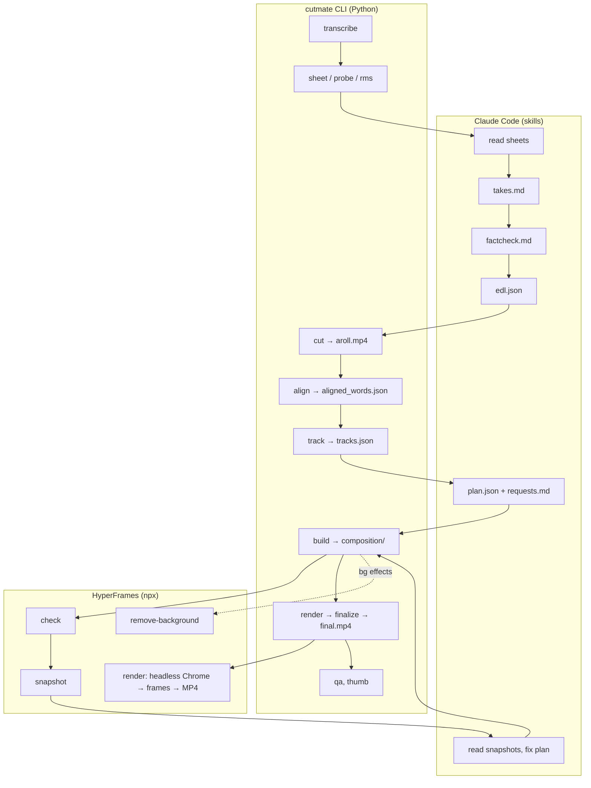

# Architecture

This page explains how cutmate is put together: who decides what, where files live, the two contracts between Claude and the engine (`edl.json` and `plan.json`), and how renders stay offline and deterministic.

## The big idea: Claude decides, the CLI executes

cutmate has two halves:

| Half | What it is | Responsibilities |
|---|---|---|
| **Skills** (`skills/*/SKILL.md`) | Instructions Claude Code follows | Editorial judgement: reading frames, picking takes, fact-checking, mapping requests, planning graphics, checking snapshots, talking to you |
| **Engine** (`core/cutmate/`, the `cutmate` CLI) | Python 3.10+ | Everything that must be exact and repeatable: transcription, cutting, loudness, alignment, tracking, building and rendering the composition, validation, QA |

The two talk through **files in `out/`**, never through hidden state. Each step writes a file, the next step reads it, and `/cutmate:edit` resumes from the first missing one. Because every decision is a readable file (`takes.md`, `edl.json`, `plan.json`, `requests.md`), you can audit an edit or change it by hand.

The engine is strict. It validates every plan and rejects bad anchors, overlapping budgets, forbidden code in effects, missing libraries and stale tracks, always with a one-line message that names the fix. The skills are written so that Claude fixes every error and thinks about every `WARN` before you see anything.

## Pipeline



## Repository layout

```text
cutmate/
├── .claude-plugin/
│   ├── plugin.json            # plugin manifest (name, version, dependency on hyperframes@hyperframes)
│   └── marketplace.json       # this repo is its own marketplace
├── skills/
│   ├── setup/SKILL.md         # /cutmate:setup
│   ├── edit/SKILL.md          # /cutmate:edit
│   ├── theme/SKILL.md         # /cutmate:theme
│   ├── theme/generate.md      # shared recipe: direction → theme files (used by theme and clone-style)
│   └── clone-style/SKILL.md   # /cutmate:clone-style
├── core/cutmate/              # the Python package behind the `cutmate` CLI
│   ├── cli.py                 # argparse entry point, every subcommand
│   ├── config.py              # ~/.cutmate/config.json: keys, defaults, validation
│   ├── backends/              # transcription: local (faster-whisper / mlx-whisper), groq, openai, elevenlabs
│   ├── transcribe.py, takes.py, sheet.py, formats.py
│   ├── cut.py, align.py, ctc.py, tracks.py
│   ├── plan.py                # plan.json validation, anchors, budgets, density, WOW caps
│   ├── build.py               # plan → HyperFrames project (composition/), captions.srt, chapters.txt
│   ├── effects.py             # custom effect discovery, lint (determinism rules), save-effect
│   ├── layout.py              # classic vs split-panel
│   ├── render.py, finalize.py, preview.py, qa.py, thumb.py, shot.py, music.py
│   ├── themes.py, theme_check.py, directions.py, fonts.py
│   ├── doctor.py, selftest.py, smoke.py, vendor.py, cuda.py, hf.py
│   └── web/                   # cutmate.js + effects.js: the runtime loaded into every composition (U.*)
├── themes/clean/              # the bundled neutral theme (components, custom effects, fonts, tokens)
├── assets/
│   ├── sfx/                   # 6 CC0 sound effects + manifest + licences
│   ├── vendor/                # pinned JS libraries + MANIFEST.json (sha256) + LICENSES/
│   └── brand/                 # README banner and social preview
├── install/                   # detect.sh / detect.ps1 (report), setup.sh / setup.ps1 (venv)
├── tools/                     # maintainer scripts: vendor_libs.py, fetch_assets.py
├── tests/                     # pytest suite (fast by default; -m hf / -m net / -m slow for the heavy ones)
└── docs/                      # this documentation
```

## HyperFrames

[HyperFrames](https://github.com/heygen-com/hyperframes) (Apache-2.0, by HeyGen) renders HTML to video. A composition is an HTML page with timed clips on one **paused** timeline. The renderer seeks the page to each frame in headless Chrome, captures it, and encodes the frames together with the audio.

cutmate pins one version and runs it through `npx` (`core/cutmate/hf.py`):

```bash
npx --yes hyperframes@0.8.157 <command>
```

| HyperFrames command | Used by | For |
|---|---|---|
| `check` | `render`, `theme check` | Validates the composition. A run cut off by the 120 s deadline on a busy machine is retried once, then only warned about. |
| `snapshot` | `/cutmate:edit` (Claude) | Frames at the build's checkpoints, for Claude to read |
| `render` | `cutmate render` | The full render to `out/work/render.mp4` |
| `remove-background` | `build` (for `bg` effects) | Speaker cut-out (about 17× the clip duration on a CPU) |
| `media-use resolve` | Skills | Music beds and AI images, only when you are signed in to HeyGen |

The HyperFrames **plugin** (installed from its own marketplace) provides the audio carve script that ducks music under the voice.

### What `cutmate build` produces

```text
out/composition/
├── index.html                 # root composition: A-roll, captions, one host per graphic, audio tracks
├── compositions/              # one sub-composition per graphic (<id>.html)
└── assets/
    ├── aroll.mp4              # the cut
    ├── media/                 # b-roll, cut-outs, face clips
    ├── fonts/, sfx/, bgm/     # theme fonts, sound effects, the music bed
    └── vendor/<lib>@<ver>/    # only the libraries this project loads (GSAP always)
```

Every graphic is a theme component (`themes/<theme>/components/<type>.html`) with `<style>`, `<markup>` and `<script>` sections. It is filled with the graphic's parameters and animated on the shared timeline, so it is seek-safe by construction.

## The contracts: `edl.json` and `plan.json`

### `edl.json`: the cut

Written by Claude after `takes.md`, read by `cut`, `align`, `build` and `requests`.

```json
{"format": "9:16", "fps": 30,
 "segments": [
   {"id": "S1", "file": "IMG_6048.MOV", "in": 1.83, "out": 12.22, "text": "corrected text, exactly as said"},
   {"id": "S2", "file": "IMG_6051.MOV", "in": 0.40, "out": 6.95, "text": "…"}],
 "spoken": {"Claude": "klod", "75%": "siedemdziesiąt pięć procent"}}
```

| Field | Meaning |
|---|---|
| `format` | `9:16` or `16:9` |
| `segments[].id` | `S1`, `S2`, … in video order; used in anchors |
| `segments[].file`, `in`, `out` | Source clip and its time range (seconds), cut on silence boundaries |
| `segments[].text` | The caption source of truth: names spelled right, never reworded |
| `spoken` | How numbers and foreign words are pronounced, for the aligner |

### `plan.json`: everything on screen

Written by Claude, validated and built by `build`.

```json
{"captions": {"key": ["CLAUDE", "CAVEMAN"]},
 "graphics": [
   {"type": "counter", "at": "S2:75", "to": 75, "prefix": "-", "suffix": "%", "label": "TOKENS", "hit": true},
   {"type": "split", "from": "S5:Po", "to": "S5:zwięźle.", "media": "broll/caveman-repo.png"},
   {"type": "custom", "name": "kinetic-word", "from": "S6:to", "to": "S6:start.", "params": {"text": "+300%"}}],
 "music": {"src": "/abs/path/bed.mp3"}}
```

| Key | Meaning |
|---|---|
| `captions.key` | Words drawn in the accent colour (inflected forms match too) |
| `graphics` | Components and effects (see [effects.md](effects.md#built-in-components-for-reference)) |
| `panel` | Split-panel themes: the contiguous timeline of panel items `{at, until?, effect + params \| media, fit?, sfx?}` |
| `scenes` | Split-panel themes: full-frame moments `{from, to, media \| effect + params}` |
| `chapters` | 16:9: `[{"at": "S1:word", "title": "…"}]` (plates for chapter 2 onward) |
| `chapter_fx` | 16:9: `"topic-change"` turns the plates into the WOW glitch |
| `face` | Per-segment face position `[x, y]` (fractions of the frame); filled from `tracks.json` when missing |
| `music` | A specific bed (`src`, optional `volume`); folder music needs no entry |

**Anchors** tie graphics to words, so they survive re-cuts: `"S2:word"` is the first occurrence of the word in segment S2, `"S2:word#2"` is the second, and a number means seconds into the cut video. `"S2:75"` also matches a spoken "75%".

**What the planner enforces:** a `list` has at most 4 items, `bars` at most 3 rows, a `stamp` is one word, and `counter.to` is a number. It also enforces budgets (at most 2 `hit` graphics, 1 `title`, no overlaps), density (a visual on screen at least 50 % of the time; bare face never longer than 4 s in 9:16 or 20 s in 16:9, apart from the hook and the CTA tail), the WOW caps, panel cadence and gaps, and the rule that `split` is not allowed in 16:9.

## Determinism

Renders seek frames independently, often in parallel, so every frame must be a pure function of time:

- Components and effects animate through **one paused timeline** (GSAP) or through `U.clock(t)`, the only per-frame driver in custom effects.
- Randomness comes only from `U.seed(n)`.
- `effects.py` lints every custom effect and **rejects** wall-clock time, `Math.random`, timers, `requestAnimationFrame`, play / restart calls, crossing callbacks (`onComplete` …), library randomness, and unvendored three.js addons. The full list is in [effects.md](effects.md#determinism-rules).
- `theme check` renders every component in both formats before a theme can be saved. The test suite pins byte-identical "golden" builds for the main layouts.

## Offline vendoring

**Builds and renders never fetch a library from the network.** Every JavaScript and CSS file a composition can load is pinned in `assets/vendor/MANIFEST.json`, together with its version, source URL, licence and the **sha256 of every file**.

| Library | Version | In the repo? |
|---|---|---|
| three.js (+ selected addons and fonts) | 0.181.2 | Yes |
| postprocessing | 6.39.5 | Yes |
| anime.js | 4.5.0 | Yes |
| lottie-web | 5.12.2 | Yes |
| KaTeX (+ fonts) | 0.19.0 | Yes |
| Rough.js | 4.6.6 | Yes |
| D3 | 7.9.0 | Yes |
| **GSAP** (+ DrawSVG, MorphSVG, MotionPath, SplitText) | 3.14.2 | **No**: `"redistribute": false` |

GSAP's licence does not clearly allow redistribution, so the repo ships only its licence text and hashes. `cutmate vendor` downloads the files from jsDelivr into `~/.cutmate/vendor/gsap@3.14.2/`, checks each against the manifest, and writes nothing that fails the check. `setup.sh` / `setup.ps1` run it automatically, and `cutmate doctor` → `vendor` reports it. `build` resolves every library a project needs **before writing any file**, so a missing GSAP fails cleanly with "run `cutmate vendor`".

At build time, only the libraries the project actually uses are copied into `composition/assets/vendor/`. For maintainers, `tools/vendor_libs.py` re-downloads everything, regenerates the manifest and licences, and rebuilds the globe data from Natural Earth.

## The cutmate home

User data lives outside the plugin, in `${CUTMATE_HOME:-~/.cutmate}`: config, venv, models, GSAP, your themes, theme checks, clone work files and the smoke test (see [configuration.md](configuration.md#what-lives-in-the-cutmate-home)). Updating or reinstalling the plugin never touches it. After an update, run `/cutmate:setup` once: it notices that the venv points at the old plugin folder and reinstalls.
